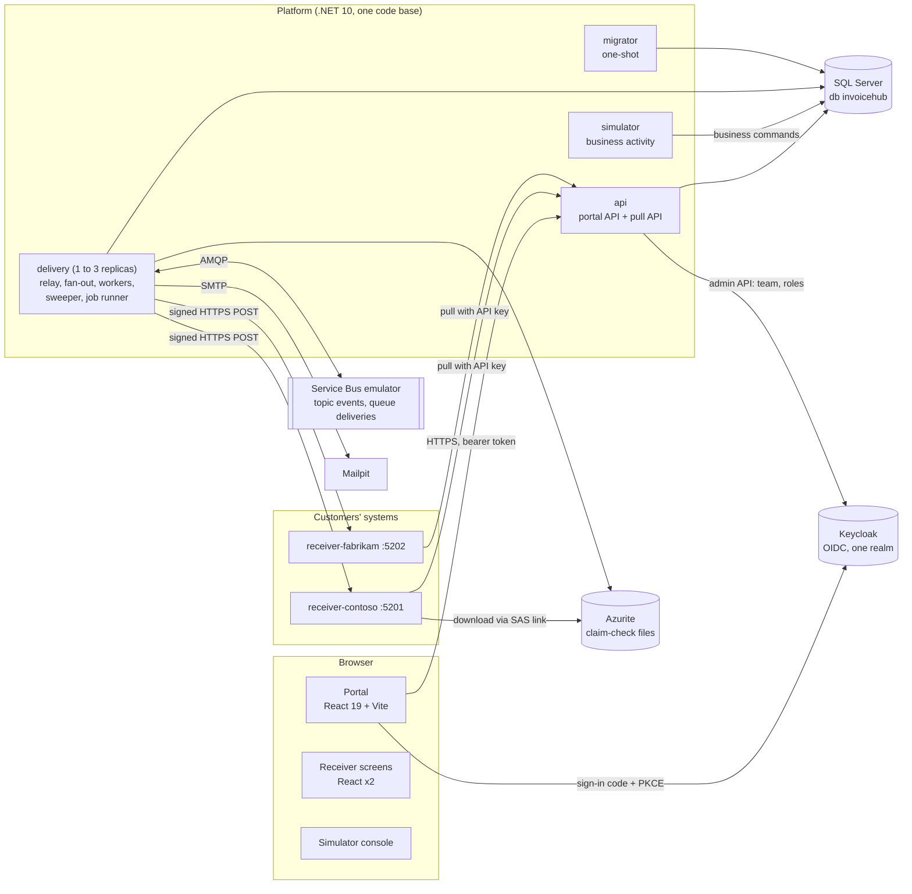
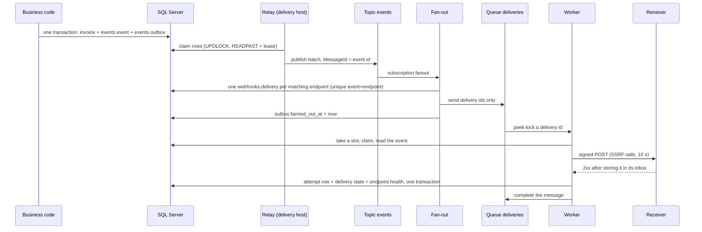

# InvoiceHub demo: technical design

For developers and tech leads. This describes what the demo is made of, how the parts talk to each other, how the modular monolith is put together, and what that buys you if you later move towards microservices. Everything here was checked against the code and the test results of 2026-11-13; where something is a measurement or a limit, it says so.

Related documents: [DELIVERY-DESIGN.md](DELIVERY-DESIGN.md) (how delivery works and why nothing is lost), [ASR-PROOF.md](ASR-PROOF.md) (every requirement, the test that proves it, what is not proven), [LOAD-RESULTS.md](LOAD-RESULTS.md), [RUNBOOK.md](RUNBOOK.md), [DEMO-NOTES.md](DEMO-NOTES.md) (presenter's crib sheet).

## 1. The system at a glance

InvoiceHub is a small SaaS platform that sends **webhooks** to its customers' systems. It has tenants (Contoso, Fabrikam), a tenant portal, and a delivery pipeline built on a message broker. The customers' own systems are simulated by two **receiving applications** that are deliberately *not* part of the platform code base.



The whole topology is one **.NET Aspire** AppHost (`src/AppHost`): 24 resources, one command, one dashboard (<http://localhost:15180>) with logs, traces and health. The tests boot the same AppHost, so the topology you demo is the topology that is tested.

### Components

| Component | Technology | Role | Address |
|---|---|---|---|
| `portal` | React 19, Vite, TypeScript (strict), TanStack Query, React Router, `oidc-client-ts` | The tenant portal: endpoints, delivery logs, replay, settings | :5173 |
| `api` | ASP.NET Core minimal APIs, .NET 10 | Portal API (`/api/portal/*`), public JWKS (`/api/public/*`), **pull API** (`/v1/events`, `/v1/kyc/{id}`) | :5100 |
| `delivery` | .NET 10 worker host with a health endpoint | Outbox relay, fan-out consumer, delivery workers, retry sweeper, job runner. Runs 1 replica (demo) to 3 (`delivery-b`, `delivery-c` start by hand) | dynamic |
| `simulator` | .NET 10 + static console | Plays the platform's customers: invoices, exports, imports, KYC, renewals | :5400 |
| `migrator` | .NET 10 one-shot job | Applies every module's SQL scripts, creates the two application logins, seeds tenants and endpoints | none |
| `receiver-contoso`, `receiver-fabrikam` | ASP.NET Core, own SQL database each | The customers' systems: verify, inbox, process, pull, reconcile. One program, started twice with different settings | :5201, :5202 |
| `receiver-*-web` | React (one app, run twice) | The receivers' own screens | :5174, :5175 |
| `keycloak` | Keycloak 26, one realm `invoicehub` | OIDC provider, users, roles, tenant claim | :8085 |
| `sql` | SQL Server 2022 container | Three databases: `invoicehub`, `receiver-contoso`, `receiver-fabrikam` | dynamic |
| `servicebus` (+ `servicebus-mssql`) | Azure Service Bus emulator 2.0.0 | Topic `events` (subscription `fanout`), queue `deliveries` | AMQP, dynamic |
| `storage` | Azurite | Blob container `claim-checks` (private) | dynamic |
| `mailpit` | Mailpit | Catches every alert email | :8025 (web), :1025 (SMTP) |

## 2. How the pieces talk

| From | To | How | Auth | Sync? | What travels |
|---|---|---|---|---|---|
| Browser | Keycloak | OIDC authorization code with PKCE (public client `portal`) | the user's password | redirect | `tenant_id` and `roles` claims end up in the access token |
| Portal | `api` | HTTPS JSON | bearer JWT, header `X-Selected-Tenant` | sync | portal requests. The API checks the token's tenant against the selected one |
| `api` | SQL Server | TDS, login `api_user` | SQL login | sync | each connection gets `SESSION_CONTEXT('tenant_id')` set from the token |
| `api` | Keycloak admin API | HTTPS | client credentials | sync | team and role changes, user disable |
| Business code (Billing, Jobs, Compliance) | SQL Server | one transaction | n/a | sync | the business row, the event row and the **outbox** row commit together |
| `delivery` relay | Service Bus topic `events` | AMQP batch send | connection string | async | `EventEnvelope` (ids, type, trace): `MessageId` = event id, duplicate detection on |
| `delivery` fan-out | SQL, then queue `deliveries` | SQL, AMQP | n/a | async | one `webhooks.delivery` row per matching endpoint, then a message with **ids only** |
| `delivery` worker | queue `deliveries` | AMQP peek-lock, explicit settle | n/a | async | `DeliveryMessage` (delivery id, tenant id, attempt, trace) |
| `delivery` worker | customer receiver | HTTPS POST, SSRF-safe | **signature** (HMAC `v1` and/or ES256 `v1a`) plus an optional static header | sync, 10 s timeout | body + `webhook-id`, `webhook-timestamp`, `webhook-signature`, `traceparent` |
| `delivery` job runner / workers | Azurite | Blob SDK | key; links are read-only **SAS** | sync | export files streamed in; expiring link per attempt |
| Receiver | `api` pull API | HTTPS | **API key** (`ihk_…`, scoped) | sync | `GET /v1/events` (stream), `GET /v1/kyc/{id}` (personal data) |
| Receiver | Azurite | HTTPS | the SAS link from the event | sync | the claim-checked file, hashed while streaming |
| `delivery` notifications | Mailpit | SMTP | none (demo) | async | alert emails |
| Everything | Aspire dashboard | OTLP | n/a | async | logs, metrics, traces |

Three rules of thumb that explain the table:

1. **Between the platform and the world everything is HTTP and signed.** Between the platform's own parts, state lives in **SQL** and the broker carries **ids only**.
2. **Nothing important happens in a request path that is not in a transaction.** The request writes rows; workers do the talking.
3. **Every hop carries the trace.** `traceparent` is stored on the event, copied into the broker message, used for the delivery attempt, and sent to the receiver (section 8).

## 3. The modular monolith

### 3.1 What it is

One code base and one solution (`InvoiceHub.slnx`), organised as **modules**. A module is two assemblies:

```
src/Modules/Webhooks/
    InvoiceHub.Webhooks           implementation: persistence, handlers, endpoints (mostly internal)
    InvoiceHub.Webhooks.Contracts the public surface: interfaces and records other modules may use
    InvoiceHub.Webhooks.Core      pure logic (signing, retry, breaker, SSRF, filters): no framework, no I/O
```

| Module | Schema | Owns | Used by others through (Contracts) |
|---|---|---|---|
| Tenancy | `tenancy` | tenants, user profiles, API keys, team management (through the Keycloak admin API) | `ITenantDirectory`, `ITeamDirectory` |
| Events | `events` | canonical event store, **transactional outbox**, relay, pull API, event catalogue (42 types) | `IEventPublisher`, `IEventReader`, `IFanOutTracker`, `IEventCatalog` |
| Webhooks | `webhooks` | endpoints, secrets, subscriptions, deliveries, attempts, slots, replay jobs, signing, SSRF guard | status constants only: other modules learn about it through **events** |
| Billing | `billing` | invoices (the simulated business domain) | `IInvoiceCommands`; publishes events |
| Audit | `audit` | append-only audit log | `IAuditLog` |
| Notifications | `notifications` | alert rules, inbox (the bell), email | nothing: it only reacts to events |
| Jobs | `jobs` | export and import jobs, the job runner | `IJobCommands`; publishes events |
| Compliance | `compliance` | identity verifications, the **only** place with personal data | `IKycCommands`; the audited pull is an HTTP route; publishes `kyc.completed` |

**Hosts are composition roots.** `Api`, `Delivery`, `Simulator` and `Migrator` hold no business logic and no data access. Each lists the modules it runs:

```csharp
// Hosts/InvoiceHub.Api/Program.cs
IModule[] modules = [new TenancyModule(), new AuditModule(), new EventsModule(), new WebhooksModule(), new NotificationsModule(), new ComplianceModule()];

// Hosts/InvoiceHub.Delivery/Program.cs
IWorkerModule[] modules = [new EventsModule(), new WebhooksModule(), new NotificationsModule(), new JobsModule()];
```

`IModule.ConfigureServices` registers a module's services, `MapEndpoints` maps its HTTP routes. `IWorkerModule.ConfigureWorkers` adds its background services. **Only worker hosts call `ConfigureWorkers`**, so API replicas never compete with the relay or the sweeper, and the same module is a request handler in one process and a worker in another.

### 3.2 The rules, and who enforces them

The rules are not conventions. 28 architecture tests (`tests/InvoiceHub.ArchitectureTests`, NetArchTest plus static checks of the SQL scripts) fail the build when one is broken:

| Rule | Test |
|---|---|
| A module never references another module's implementation | `A_module_never_references_another_modules_implementation` |
| A module reaches the rest only through the shared kernel and Contracts | `A_module_reaches_the_rest_of_the_system_only_through_the_shared_kernel_and_contracts` |
| Contracts are plain: no infrastructure | `Contracts_assemblies_are_plain_and_do_not_pull_in_infrastructure` |
| Module internals stay internal; small modules expose only their entry point | `Module_internals_stay_internal`, `Small_modules_expose_nothing_but_their_entry_point` |
| Hosts hold no data access; the shared kernel knows no module | `Hosts_are_composition_roots_and_hold_no_data_access`, `The_shared_kernel_knows_no_module` |
| The broker adapter and the blob adapter know only the shared kernel; no module touches the cloud SDK | `The_message_broker_adapter_knows_only_the_shared_kernel`, `…blob_storage_adapter…`, `No_module_talks_to_the_cloud_storage_sdk_directly` |
| `Webhooks.Core` is pure logic | `Webhooks_core_is_pure_logic_with_no_framework_or_infrastructure` |
| The receiver is an independent application | `The_receiver_is_an_independent_application` |
| **A module creates and references only its own SQL schema** | `A_module_creates_and_references_only_its_own_schema` |
| Every table with a `tenant_id` is covered by the row-level-security policy | `Every_table_with_a_tenant_id_is_covered_by_the_row_level_security_policy` |
| Only the Audit module has SQL on the audit table; the log is append-only for both logins | `Only_the_audit_module_has_any_sql_on_the_audit_table`, `The_audit_log_is_append_only_for_both_application_logins` |
| Personal-data columns exist only in the Compliance schema | `Personal_data_columns_exist_only_in_the_compliance_schema` |

### 3.3 How modules talk to each other

There are exactly three ways, and a fourth that is forbidden.

1. **An interface from `*.Contracts`, in process.** Example: the Webhooks module reads a committed event through `IEventReader`, writes an audit line through `IAuditLog`; the Notifications module lists people to e-mail through `ITeamDirectory`; the simulator calls `IInvoiceCommands`. The caller sees an interface; the implementation is in another assembly it cannot reference.
2. **An event through the outbox and the broker.** Example: when an endpoint reaches 50 % of its failure limit, Webhooks publishes `webhook.endpoint.degraded` in its own transaction. The Notifications module consumes it like any other event and puts a line in the bell. Webhooks does not know Notifications exists. This is already the style microservices use between each other.
3. **Shared kernel** (`BuildingBlocks`): tenant context, authentication, SQL helpers, the messaging ports (`IEventTransport`, `IDeliveryQueue`, `IClaimCheckStore`), problem responses. It knows no module.
4. **Forbidden: reading or writing another module's tables.** No cross-schema SQL, no cross-schema foreign key, enforced by the test above.

Publishing an event inside a business transaction looks like this (the caller hands over its own open transaction; nothing is sent here):

```csharp
public interface IEventPublisher
{
    Task<Guid> PublishAsync(DbTransaction transaction, DomainEvent domainEvent, CancellationToken ct = default);
}
```

### 3.4 Data: one database, schema per module, SQL-first

* One SQL Server database `invoicehub`, one **schema per module** (`events`, `webhooks`, `tenancy`, `billing`, `audit`, `notifications`, `jobs`, `compliance`) plus `security` for the shared predicate. EF Core 10 `DbContext` per module; hot paths use a small raw-SQL helper where the statement matters (`UPDLOCK, READPAST`, `OUTPUT`).
* **Migrations are numbered SQL scripts** embedded in each module (`001_events.sql`, `002_…`), applied by the Migrator, journalled in `dbo.schema_journal` with a hash. Applied scripts are never edited; a change is a new script.
* **Two application logins.** `api_user` can only act for the tenant in its session context. `worker_user` may in addition switch on *system mode* for cross-tenant jobs (relay, sweeper). The API login cannot, even if the API had an injection bug.

### 3.5 Tenant isolation, enforced twice

```sql
CREATE FUNCTION security.fn_tenant_predicate (@tenant_id uniqueidentifier)
RETURNS TABLE WITH SCHEMABINDING AS RETURN
  SELECT 1 AS allowed
  WHERE @tenant_id = TRY_CAST(SESSION_CONTEXT(N'tenant_id') AS uniqueidentifier)
     OR (TRY_CAST(SESSION_CONTEXT(N'system') AS int) = 1 AND IS_MEMBER(N'worker_role') = 1);

CREATE SECURITY POLICY events.tenant_isolation
  ADD FILTER PREDICATE security.fn_tenant_predicate(tenant_id) ON events.event,
  ADD BLOCK  PREDICATE security.fn_tenant_predicate(tenant_id) ON events.event AFTER INSERT, …
```

* **In the API**: the tenant comes from the signed token (`tenant_id`), never from the request. A guessed id of another tenant is a 404.
* **In SQL**: a connection interceptor copies the tenant into `SESSION_CONTEXT` on every open. With no context at all, **no rows** are visible (fail closed). Workers set the tenant **per message**.
* Tested at both levels: a wrong-tenant id gives 404, and a raw query as `api_user` with the wrong tenant returns zero rows.

## 4. The delivery pipeline (one business change, end to end)



Key points, each with the place to look:

| Step | What happens | Code | Broker or table |
|---|---|---|---|
| Commit | The business change, the event and the outbox row are one transaction (no dual write) | `Billing` commands, `EventPublisher` | `events.event`, `events.outbox` |
| Relay | Several relays run at once; each claims a batch with `UPDLOCK, READPAST` and a lease. A crashed relay's rows become claimable when the lease runs out. Stalled events (published, never confirmed by fan-out) are published again | `OutboxRelay` | topic `events` |
| Fan-out | Match subscriptions and filters, insert one delivery per endpoint (`UNIQUE (event_id, endpoint_id)` makes it idempotent), enqueue ids, confirm to the outbox | `FanOutHandler` | `webhooks.delivery`, queue `deliveries` |
| Worker | Take one of the endpoint's slots (at most 5 in flight), claim the delivery, build the body for the delivery's API version, sign, send, classify the answer | `DeliveryHandler`, `WebhookSender`, `SsrfGuard` | `webhooks.endpoint_slot` |
| Record | Attempt row (request masked), delivery state, endpoint health and, when a threshold is crossed, a platform event, all in one transaction | `DeliveryHandler.RecordAsync` | `webhooks.delivery_attempt` |
| Retry | A scheduled broker message is the timer for waits up to 30 minutes; longer waits, and waits behind a slow receiver, live in SQL only and the **sweeper** brings them back | `RetrySweeper` | `next_attempt_at`, `dispatch_until` |
| Receiver | Verify the raw body, insert into the inbox (unique `webhook-id`), answer 2xx, process later with a sequence guard | `HookEndpoint`, `InboxProcessor` | receiver `dbo.inbox_message` |

**The rule that makes it safe: SQL decides, the broker only hurries things along.** A lost message costs time, never an event: the outbox republishes unconfirmed events and the sweeper re-queues due deliveries that have no live message. The chaos tests kill a worker process and restart the broker mid-run and lose nothing.

Failure behaviour in one table (details in [DELIVERY-DESIGN.md](DELIVERY-DESIGN.md)):

| Response | Retried | Counts for breaker | Counts for auto-disable |
|---|---|---|---|
| 2xx | done | resets | resets |
| 5xx, 408, timeout, network | yes | yes | yes |
| 429 (`Retry-After` honoured) | yes | no | no |
| other 4xx, 3xx (never followed) | yes | no | no |
| 410 | no, held | no | disables |

Backoff (standard): 5 s, 30 s, 2 min, 10 min, 30 min, 1 h, 2 h, 4 h, 8 h, 12 h, ±20 % jitter, 72 h window. Circuit opens after 5 consecutive failures, probes at 30 s doubling to 15 min. A paused or switched-off endpoint **holds** events for up to 7 days instead of dropping them.

## 5. Large results and personal data

* **Claim check.** An export of 50 MB is written to blob storage *while it streams* (no memory spike; size and SHA-256 computed on the way). The event carries an internal file reference; when each attempt is built the delivery replaces it with an envelope of about **600 bytes**: size, checksum, content type, an expiring read-only link (a SAS minted **per attempt**, default 15 minutes). The receiver downloads and hashes while streaming and compares. A link with one changed character is refused. The container and blob name never appear in logs or the pull API.
* **Thin events.** `kyc.completed` carries ids and a decision. Personal data sits in one table of one module (`compliance.verification`, enforced by a test). The receiver pulls `GET /v1/kyc/{id}` with an API key that has the `kyc:read` scope, and the platform **writes the audit line before** it returns the data. A canary test puts a name into a verification and proves it appears nowhere in the event store, the broker, the webhook or the logs.
* **Reconciliation.** `GET /v1/events` lists the stream oldest first with a cursor. The receiver's *Did I miss anything?* walks it, finds what its inbox lacks and feeds it into the same idempotent inbox. Webhooks are hints; the API is the truth.

## 6. Security, in layers

| Layer | What the demo does | Where |
|---|---|---|
| Identity | Keycloak, one realm; OIDC code + PKCE; access token carries `tenant_id` and `roles`; five roles (owner, admin, developer, support, viewer) mapped to eleven permissions that are authorization policies | `Auth.cs`, `Permissions.cs`, `infra/keycloak` |
| Tenant check | Token tenant vs the tenant the user picked: a mismatch is refused. Then RLS in SQL (section 3.5) | `TenantContext`, `001_security.sql` |
| Step-up | Revealing a signing secret, rotating keys, changing the algorithm and creating an API key need a **fresh sign-in** (`prompt=login&max_age=0`); the API checks `auth_time` within 5 minutes, not the screen | `StepUp.cs` |
| API keys | `ihk_{tenant}_{keyId}_{secret}`; only the SHA-256 is stored; shown once; scopes `events:read`, `kyc:read`; the tenant part is set **before** the lookup so the lookup itself runs under row-level security | `ApiKeyAuthentication` |
| Message authenticity | Standard Webhooks: `webhook-id`, `webhook-timestamp`, `webhook-signature`. HMAC-SHA256 `v1`, and ES256 `v1a` with a public JWKS; several keys at once so rotation has an **overlap**; 5-minute tolerance; verified with the unmodified reference library in tests | `Signing.cs`, `Es256.cs` |
| Outbound safety (SSRF) | HTTPS only in production, no credentials in the URL, infrastructure ports refused; the host is resolved, **every** address must be public, the connection goes to exactly the address that was checked (defeats DNS rebinding); redirects never followed; reply capped at 4 KB. Only in Development a small allow-list admits the local receivers | `SsrfGuard`, `WebhookSender` |
| Secrets at rest | Signing secrets, delivery credentials and ES256 private keys encrypted with AES-GCM under a master key (user secrets here; a vault in production). Never returned by the API after creation, masked in logs | `SecretProtector.cs` |
| Data minimisation | Thin events for PII classes (the sender forces it), personal data in one schema, payload bodies in the log only for roles with `payloads:view` | `Compliance`, `DeliveriesApi` |
| Audit | Append-only, written **in the same transaction** as the change, actor, role, IP, trace id; `DENY UPDATE, DELETE` for both logins | `Audit` module |
| Abuse | Rate limiting per client address on public and test-send routes; request limits; problem responses with stable codes | `RateLimiting.cs`, `Problems.cs` |
| Not built (stated, not hidden) | OAuth client-credentials and mutual-TLS delivery authentication, payload encryption (JWE), a per-tenant throughput quota, a Content-Security-Policy | [ASR-PROOF.md](ASR-PROOF.md) |

## 7. Scaling shape

* **The API scales by replicas** behind any load balancer: it is stateless; the tenant is in the token.
* **Delivery scales by replicas** that *compete* for the same outbox rows (`READPAST`), the same subscription and the same queue. Adding a replica adds capacity with no configuration; killing one loses nothing. Measured with a 1 s receiver and 13 endpoints: **11, 25 and 36 deliveries per second with 1, 2 and 3 workers** (about ×1, ×2.2, ×3.2).
* **One endpoint cannot show scale-out**: at most 5 requests are in flight to one endpoint (configurable up to 10) however many workers there are. That cap is what protects a slow customer.
* **The broker is the demo's ceiling.** Latency stays under a second up to about 15 events per second; at 50 events per second a burst stalls for about 12 s in the broker-facing stages (one delivery attempt itself takes 9 ms). The cause is *suspected* to be the Service Bus emulator (50 to 160 receive-and-complete operations per second in total, Spike 0); it is **not proven** and the 50 events/s target needs a real namespace. See [LOAD-RESULTS.md](LOAD-RESULTS.md).

## 8. Observability

One trace per business change, carried by the W3C `traceparent`:

1. the simulator starts an activity for each invoice; the event row stores its `trace_parent` at commit;
2. the relay puts it into the broker message properties; the consumers continue it;
3. the delivery attempt records its `trace_id` and the HTTP client sends `traceparent` to the receiver;
4. the receiver stores it in its inbox.

So the id in the portal's delivery log, the id in `events.event` and the id in the receiver's inbox are the same (test `ASR_13_one_trace_id_follows_an_event…`). Logs, metrics and traces go through OpenTelemetry (OTLP) to the Aspire dashboard; SQL command logging is switched to warnings because a database-bound pipeline otherwise logs thousands of lines a second.

## 9. Testing

| Suite | What | Count (final run) |
|---|---|---|
| Unit | signing vectors and the reference library, retry, breaker, SSRF, filters, versions, envelope, API keys, masking | 264 |
| Architecture | the rules of section 3.2 | 28 |
| Integration, real stack | boots the AppHost (SQL, Keycloak, broker, Azurite, Mailpit, all hosts): pipeline, **chaos** (kill a worker, restart the broker), portal API, replay, audit, API keys, claim check, thin events, versions, ASR scenarios | 67 passed, 2 opt-in load runs |
| Portal unit | React logic | 74 |
| Browser | Playwright against the live stack, **axe** accessibility checks in both themes on every screen | 46 |
| Load (opt-in) | latency against offered rate, throughput with 1/2/3 workers | 2 |

## 10. From modular monolith to microservices

### 10.1 What "modular" buys here, concretely

Each item is a property of this code base that you can point at, not a hope.

1. **The seams exist and are checked.** Every module has a Contracts assembly and nothing else is visible from outside; 28 tests fail the build if that erodes. In a normal monolith this is the work you would have to do *before* extracting anything.
2. **The data is already separable.** A module creates and references only its own schema. There is no cross-schema foreign key and no cross-schema query, so a module's tables can move to their own database by copying them and changing a connection string. Row-level security keys on `tenant_id`, which travels with the data.
3. **The communication style between services already exists.** Modules that must react to each other already do it with events through an outbox and a broker (Notifications reacting to Webhooks). Extracting such a module changes where it runs, not how it is told. The outbox, idempotent consumers, stable ids and `traceparent` are in place.
4. **Deployment units are already separable.** The same code runs as `api` (request handling) and `delivery` (workers, 1 to 3 replicas). A host is just a list of modules, so a new service is a new host that lists one module.
5. **Infrastructure sits behind ports.** `IEventTransport`, `IDeliveryQueue`, `IClaimCheckStore` isolate the broker and the blob store; tests prove the adapters know only the shared kernel.
6. **There is one independent application already.** The receiver is not a module: it has its own database and talks to the platform only over HTTP. It is a small, working example of "a service that is not in the monolith".

### 10.2 What you keep by *not* splitting yet

* **One transaction for the business change, the event and the outbox row.** Between services this becomes a saga or at least an outbox per service; here it is one `BEGIN TRAN`.
* **Refactoring is a compiler job.** Moving a type across modules is a build error, not a versioned network contract.
* **One thing to run, debug and trace** (F5 starts 24 resources; one dashboard).
* **The decision stays open.** You split on evidence (see 10.4), not in advance.

### 10.3 How you would extract a module (the recipe)

Take **Compliance** as the example (the strongest candidate, see 10.4):

1. Create a host `InvoiceHub.Compliance.Service` that lists only `new ComplianceModule()`. It already has everything it needs: its own schema, its own migrations.
2. Give it its own database: copy the `compliance` schema, switch the connection string. Nothing else references it.
3. Replace the in-process Contracts the others use with a client of the same interface (HTTP or gRPC) that talks to the new service. The callers do not change; the interface is the contract.
4. Events the module publishes (`kyc.completed`) already go through the outbox and the broker: they keep working, with the outbox now in the module's own database.
5. Authentication between services: the token already carries the tenant; propagate it, or use mutual TLS or a service identity.
6. Own pipeline, own deployment, own alerts. The trace id already crosses the boundary.

### 10.4 What would justify the cost, and the order

| Module | Reason to extract | Difficulty |
|---|---|---|
| **Compliance** | A different security boundary: personal data, its own database, its own access and audit | Low: small contract (`kyc.completed` out, the audited pull in) |
| **Notifications** | Only consumes events; nobody calls it | Low, but little to gain |
| **Webhooks delivery** (the worker half) | Different load profile, scales alone; already a separate host | Medium: split the *delivery* part from the *endpoint management* part of the module first |
| **Events** (outbox, relay, pull API) | A platform capability reused by others | Medium to high: everybody depends on it |
| **Tenancy, Audit** | Foundational: identity, tenants, the audit sink | Last. Many callers; they are the shared kernel in disguise |
| **Billing, Jobs** | Stand-ins for the customer's own business systems | Not extracted: in real life they are other teams' systems |

Split when you can name the force: a team that must deploy on its own cadence, a part that needs ten times the replicas of the rest, a security boundary, a different technology, a blast radius you cannot accept. If you cannot name it, the cost below is all you get.

### 10.5 What the split costs (so nobody is surprised)

* **Chatty contracts become network calls.** Today `IEventReader.GetAsync` is read once per delivery message and `ITeamDirectory.ListActiveAsync` runs per alert. Over a network they need a local read model, a cache, or fatter messages.
* **Partial failure.** A call that never failed can now time out; every Contracts call needs a timeout, retry policy and a defined behaviour when the other side is down.
* **Consistency.** What was one transaction becomes eventual consistency: idempotent consumers (we have them), ordering per aggregate (we carry `sequence`), and reconciliation.
* **Contract versioning.** A change to a Contracts type becomes a compatibility problem between deployments; today it is a compile error.
* **Operations.** More pipelines, more dashboards, service-to-service identity, local development that needs several things running (the Aspire AppHost already makes that tolerable).
* **The "distributed monolith"** is the failure to avoid: services that share a database or must be deployed together. The tests that forbid cross-schema access are exactly the guard against it.

### 10.6 What we did and did not show

We did **not** extract a module; the claims above are structural, backed by rule tests and by the fact that the platform already runs as two roles from one code base. The Webhooks delivery half, the first candidate for splitting by load, was not split because the measured limit today is the broker, not the process boundary.

## 11. Where to look in the code

| You want to see | Open |
|---|---|
| The topology | `src/AppHost/InvoiceHub.AppHost/AppHost.cs` |
| How hosts compose modules | `src/Hosts/*/Program.cs`, `BuildingBlocks/Modules/IModule.cs`, `IWorkerModule.cs` |
| The module rules | `tests/InvoiceHub.ArchitectureTests/ModuleRulesTests.cs` |
| Outbox and relay | `Modules/Events/InvoiceHub.Events/Relay/OutboxRelay.cs`, `EventPublisher.cs` |
| Fan-out, the delivery worker, the sweeper | `Modules/Webhooks/InvoiceHub.Webhooks/Delivery/` |
| Signing, retry, breaker, SSRF | `Modules/Webhooks/InvoiceHub.Webhooks.Core/` |
| Broker adapter | `src/Infrastructure/InvoiceHub.Messaging.ServiceBus/` |
| Claim check | `src/Infrastructure/InvoiceHub.Storage.AzureBlob/`, `Modules/Jobs/` |
| Row-level security | `BuildingBlocks/.../Migrations/001_security.sql`, `Tenancy/TenantContext.cs` |
| Receiver | `src/Receiver/InvoiceHub.Receiver.Api/` |
| The portal | `web/portal/src` |
